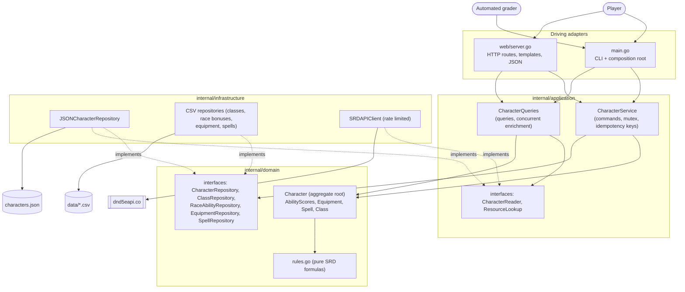
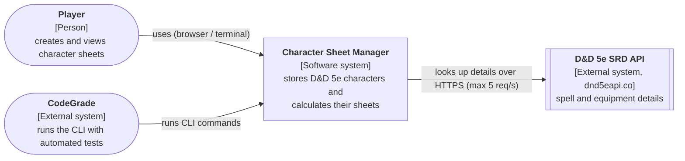
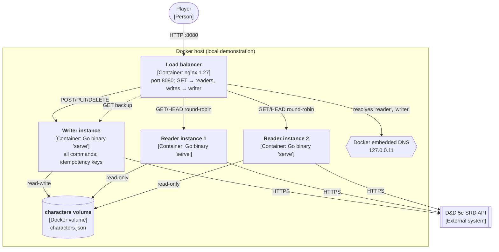
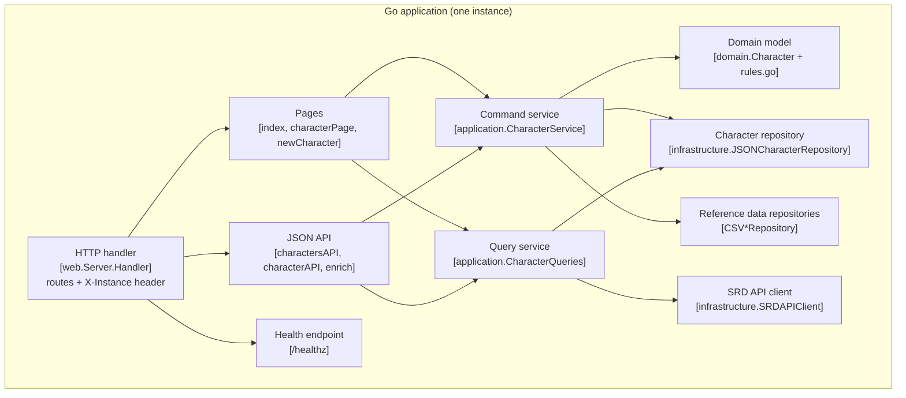
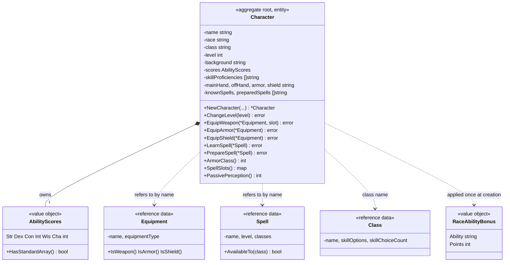
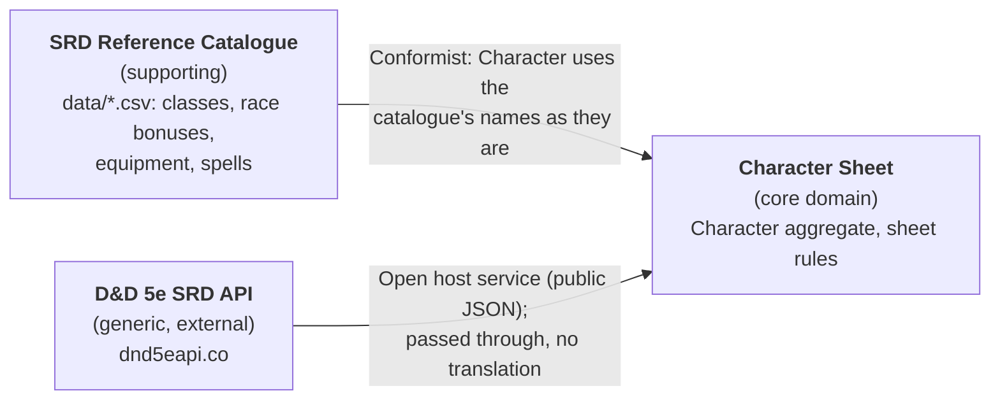

# Diagrams

All diagrams are Mermaid (text, version-controlled) and describe the code and
`docker-compose.yml` as they are. Nothing shown here is "planned" unless it is
marked *proposed*.

## 1. Architecture overview (layers and dependency direction)

Arrows mean "depends on / calls". Interfaces are implemented by the
infrastructure package, so the arrows from infrastructure point **into** the
domain and application packages.



## 2. C4 level 1 – System context



## 3. C4 level 2 – Containers (Docker demonstration)



Without Docker the same binary is one container: `go run . serve` (web) or the
CLI commands, both using `characters.json` in the working directory.

## 4. C4 level 3 – Components of the application container



## 5. Domain model



## 6. Context map



## 7. Entity-relationship diagram (persistence)

The project stores characters in one JSON document, `characters.json`: an
array of character objects. There are no foreign keys; references to the
reference data are **names** that are checked when a command runs. The CSV
files are read-only tables.

```mermaid
erDiagram
    CHARACTER {
        string Name PK "unique (enforced by CharacterService, RejectDuplicate)"
        string Race "refers to RACE_ABILITY_BONUS.race (by name)"
        string Class "refers to CLASS.class (by name)"
        int Level "1-20"
        string Background
        string_array SkillProficiencies "embedded list"
        string MainHand "refers to EQUIPMENT.name"
        string OffHand "refers to EQUIPMENT.name"
        string Armor "refers to EQUIPMENT.name"
        string Shield "refers to EQUIPMENT.name"
        string_array KnownSpells "embedded, refers to SPELL.name"
        string_array PreparedSpells "embedded, refers to SPELL.name"
        int Str "and Dex Con Int Wis Cha"
    }
    CLASS {
        string class PK
        string skill_options "semicolon list"
        int skill_choice_count
    }
    RACE_ABILITY_BONUS {
        string race "part of key"
        string ability "part of key"
        int points
    }
    EQUIPMENT {
        string name PK
        string type "Weapon, Armor, ..."
    }
    SPELL {
        string name PK
        int level "0 = cantrip"
        string class "comma list of classes"
    }
    CHARACTER }o--|| CLASS : "plays"
    CHARACTER }o--|{ RACE_ABILITY_BONUS : "race grants"
    CHARACTER }o--o{ EQUIPMENT : "equips (0-4 slots)"
    CHARACTER }o--o{ SPELL : "knows / prepares"
```

**Persistence model vs. domain model**: one `CHARACTER` object is exactly one
`Character` aggregate, including its owned lists (skills, spells) embedded in
the same object, so the aggregate is always loaded and saved as a whole
(`characterRecord` in `json_character_repository.go`). The reference tables
are *not* part of the aggregate; the character only stores their names.
**Indexes**: none. Lookups scan the array; with tens of characters this is
cheaper than maintaining an index (a database would add a unique index on
`Name`).
